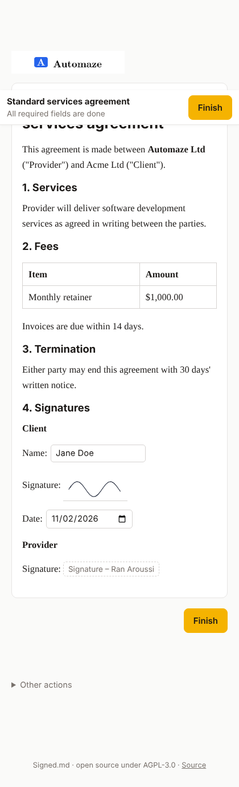

# Signed.md

**Get documents signed. One API call.**

Signed.md is an open-source, self-hosted e-signature service built for humans, developers, and AI agents. Templates are plain Markdown. Agents prepare and send agreements through a REST API or MCP. Every completed agreement comes back as a package anyone can verify offline.

An independent open-source product by VarOps.

> **Status:** v1.0 MVP. The end-to-end workflow works and is tested. Have the security, signing validity, and evidence design reviewed before you use it for production legal agreements.

<p>
  
  
  
</p>

## Why Signed.md

- **Markdown templates.** No PDFs to edit, no signature boxes to drag around.
- **Built for agents.** REST API, MCP server, and an agent skill. The server enforces the approval flow: an agent can only send the exact revision a person approved.
- **Approved terms stay approved.** Agents can draft templates, but only a person can approve them, in the web UI. The server enforces each template's limits (minimum fee, allowed notice periods, …).
- **Verifiable packages.** Each completed agreement is a ZIP with the signed Markdown, a PDF, the evidence log, and a signed manifest. Verify it without contacting the server.
- **Runs anywhere.** One Docker container, SQLite, local disk. PostgreSQL with one setting. SMTP optional.
- **Built for teams.** Invite people as owners, administrators, members, or viewers. Every action and API key is tied to a person.
- **Never deletes.** Documents and templates are revoked or archived, never deleted. People are deactivated.
- **No generative AI.** Signed.md is not an AI product. The agent brings the intelligence; Signed.md does the execution.

## Try it

```bash
pnpm install
pnpm demo
```

This starts a seeded instance at `http://localhost:3000` with two approved templates and prints an API key. You need Node.js 22.18+ and [Typst](https://github.com/typst/typst/releases) 0.13 on your `PATH`. Emails go to the **Outbox** page, so you can sign as each signer from there.

Connect Claude Code and ask it to send something:

```bash
claude mcp add --transport http signed-md http://localhost:3000/mcp --header "Authorization: Bearer <API key>"
```

> Send Acme our standard agreement for $1,000/month with a 30-day termination clause. Jane Doe (jane@acme.example) signs for Acme, then I countersign. Show me before sending.

## Run it

```bash
docker compose up -d
```

Open the URL, create the administrator, add a template, and create an API key in **Settings**. See [self-hosting](docs/self-hosting.md) for configuration, HTTPS, PostgreSQL, and backups.

## How it works

A template is Markdown with placeholders:

```markdown
# Service agreement

Client: {{$client_name:text}}
Monthly fee: {{$fee:currency(USD)}}
Plan: {{$plan:choice(standard|premium)}}

Client signature: {{client.signature:signature}}
Provider signature: {{provider.signature:signature}}
```

- `{{$name:type}}` is a **template value**, filled in when the document is created.
- `{{signer.field:type}}` is a **signer field**, filled in by that signer while signing.

Optional front matter adds limits that the server enforces:

```yaml
---
fields:
  $fee:
    minimum: "500.00"
  $notice_days:
    allowed_values: [30, 60, 90]
---
```

The lifecycle:

```text
draft → preview (revision) → person approves → send → sign → signed → finalized
```

Signers with the same `order` sign at the same time. The next group gets its link when the current group is done.

## For agents and developers

| Interface | Where |
|---|---|
| MCP | `POST /mcp` (Streamable HTTP), `Authorization: Bearer <key>` |
| REST | `/v1/...`, OpenAPI at `/openapi.json` |
| Agent skill | [`skills/signed-md/SKILL.md`](skills/signed-md/SKILL.md) |
| Webhooks | `document.awaiting_last_signer`, `document.signed`, `document.finalized`, `document.declined`, signed with HMAC-SHA256 |

## Verify a package

```bash
npx signed-md verify agreement.zip --keys signed-md-keys.json
```

`signed-md-keys.json` is the sender's `/.well-known/signed-md-keys.json`. The check confirms every file matches the signed manifest, the evidence chain is intact, and every signer signed the exact text. From this repository: `pnpm verify agreement.zip`.

## Development

```bash
pnpm install
pnpm typecheck
pnpm test                 # unit, service, and end-to-end tests
TEST_POSTGRES_URL=postgres://... pnpm test   # also run database tests on PostgreSQL
```

The acceptance test (`apps/server/test/acceptance.test.ts`) runs the full v1.0 workflow from the spec: setup and template approval in a browser, an agent over MCP, signing in a mobile browser, webhooks, and offline verification. It needs Playwright with Chromium; set `PLAYWRIGHT_PATH` if it is not installed globally.

```text
apps/server        services, REST, MCP, web UI, signing page, worker, CLI
packages/core      field engine, rendering, state machine, evidence format and verification
packages/db        schema, migrations (SQLite and PostgreSQL), job queue
packages/verify    signed-md verify CLI
skills/signed-md   agent skill
examples           sample templates
```

## Documentation

- [Technical specification](docs/spec.md)
- [REST, MCP, and agent skills](docs/integrations.md)
- [Self-hosting](docs/self-hosting.md)

## Licence

Copyright © 2026 VarOps.

Signed.md is free software under the [GNU Affero General Public License v3.0](LICENSE) (AGPL-3.0-only). You can use, change, and self-host it freely. If you run a modified version as a network service, you must offer its source code to its users. Set `SOURCE_URL` to point the "Source" link in the app at your code.
