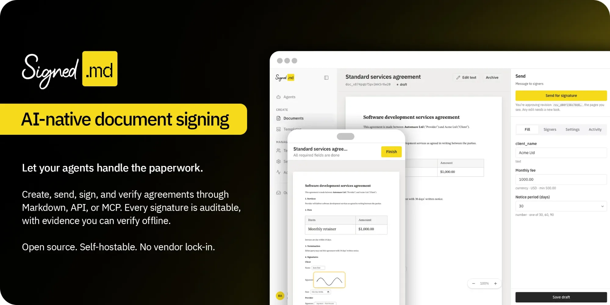
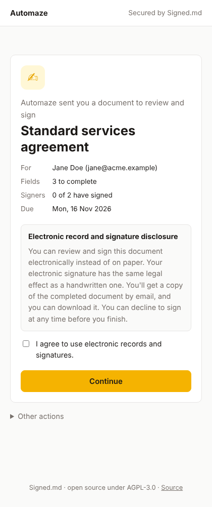
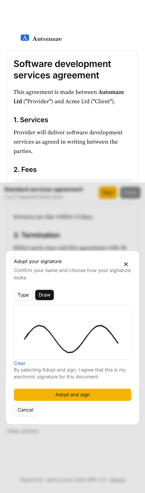
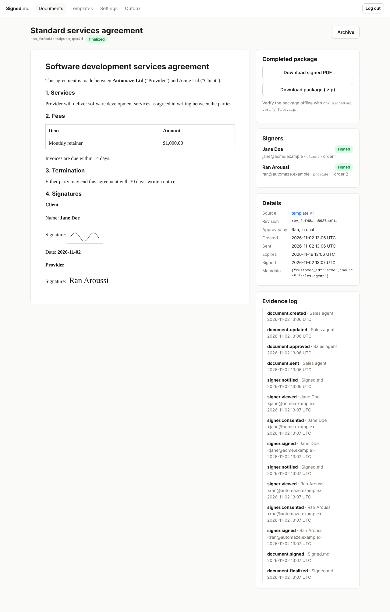
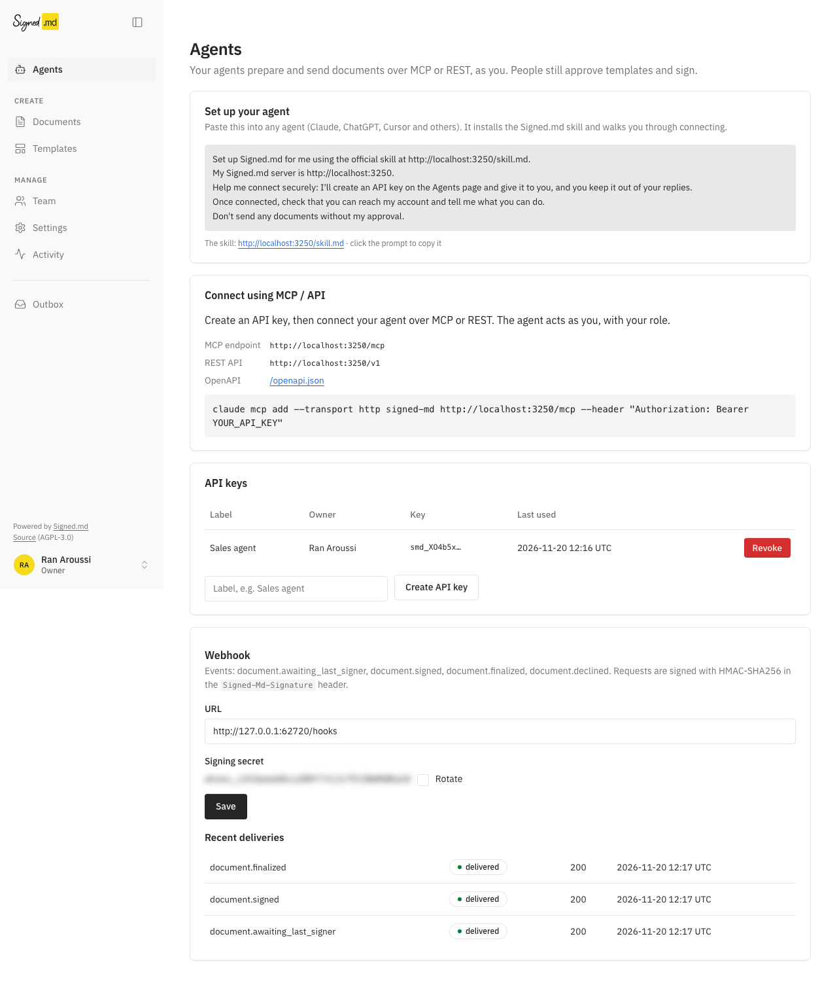
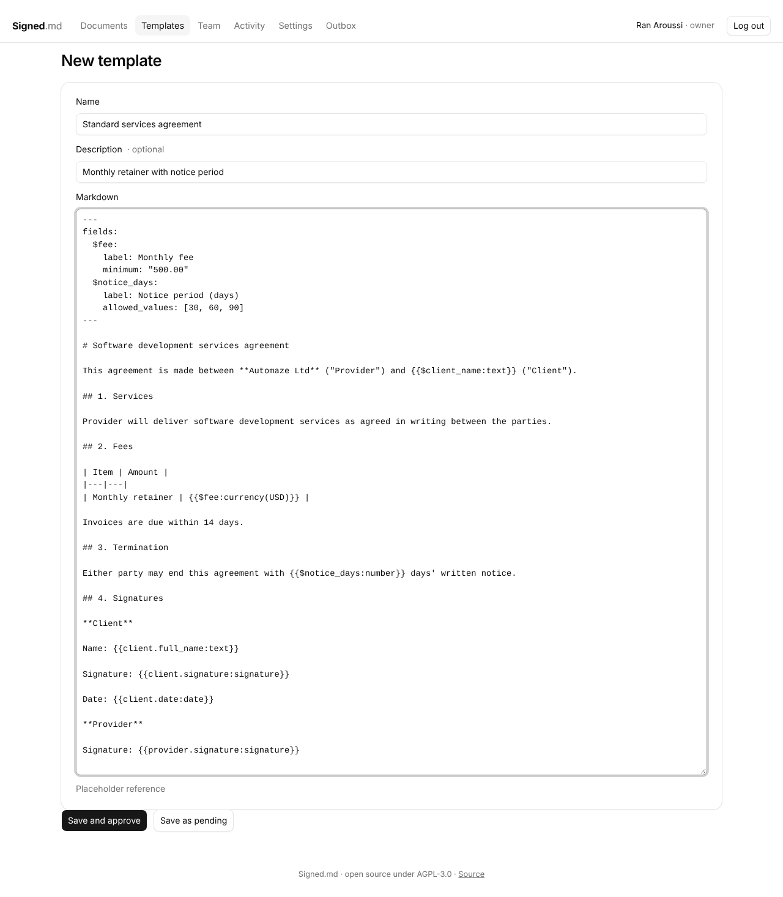
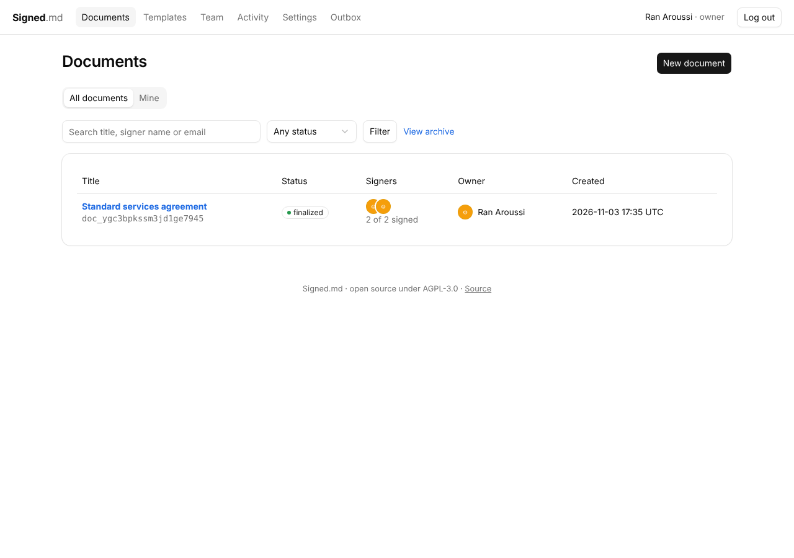
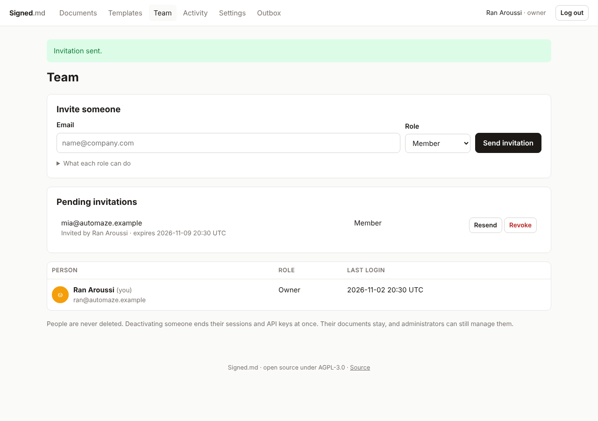

<p align="center">
  <picture>
    <source media="(prefers-color-scheme: dark)" srcset="brand/signedmd-dark.svg">
    
  </picture>
</p>

<h3 align="center">AI-native document signing</h3>

<p align="center">
  Your agent drafts and sends the agreement. People approve it and sign it.<br>
  Everyone gets a signed PDF and a package they can verify offline.
</p>

<p align="center">
  <a href="LICENSE"></a>
  
  
  
</p>

<p align="center">
  
</p>

---

E-signature tools were built for people clicking through forms. Signed.md is built for the way work gets done now: you ask an agent, and the agent does the paperwork.

Templates are plain Markdown, which every language model reads and writes well. Agents connect over MCP or REST and act as you, with your role. The server keeps the rules an agent must not bend. Only a person approves a template, and an agent can only send the exact revision a person saw. And there is no AI inside Signed.md itself. The agent brings the intelligence; Signed.md does the execution, and keeps the proof.

Open source (AGPL-3.0), self-hosted, one Docker container.

## Ask your agent

Connect any MCP client (Claude, ChatGPT, Cursor, your own) and talk to it like you'd talk to an assistant:

> Send Acme our standard services agreement for $1,000 a month with 30 days' notice. Jane Doe (jane@acme.example) signs for them, then I countersign. Show me before you send it.

Behind that one sentence, the agent:

1. finds your approved "Standard services agreement" template;
2. creates a draft with the values filled in, which the server checks against the template's limits (the fee has a minimum, notice must be 30, 60 or 90 days);
3. shows you the preview and its revision, and waits for your OK;
4. sends that exact revision. Jane signs on her phone, then you get your link;
5. tells you when it's done, and can fetch the signed PDF and evidence package for you.

You never opened a PDF editor or dragged a signature box.

## Why AI-native

**MCP and REST from day one.** 16 MCP tools over Streamable HTTP (`signed_create_document`, `signed_preview_document`, `signed_send_document` and more), the same actions over REST with an OpenAPI spec, and webhooks when things happen.

**An agent skill that sets itself up.** The Agents page gives you one prompt to paste into any agent. It installs the [Signed.md skill](skills/signed-md/SKILL.md), asks you for an API key and checks the connection.

**Markdown in, Markdown kept.** Templates are Markdown with placeholders. Agents write and read them as easily as you do, and you can import an existing Word or PDF contract in the web UI. The signed Markdown is the source of truth.

**Guardrails the agent can't talk its way around.** These live in the server, not in a prompt:

- Templates an agent writes start as pending. Only an owner can approve one, and only in the web UI.
- Every draft has a revision hash covering the text, values, signers and settings. Sending needs the exact revision a person approved. Change a comma and it needs a new look.
- Template limits (minimum fee, allowed notice periods, required fields) are checked on every draft.
- API keys belong to people and act with their current role. Members only see their own documents.

**No generative AI inside.** Signed.md never writes or rewrites your contracts. What you approve is what gets signed.

## Signing that people actually finish

<p>
  
  
  
</p>

- No account and no app. Signers open a link on any device.
- A short intro shows who sent it, what to fill in, and the e-signature disclosure.
- Fields sit inline, where they appear in the agreement. One button walks through them: Start, Next, Finish.
- Type or draw a signature once, then apply it with one tap.
- A progress panel shows who has signed, who is next and the deadline.
- Signers can download an unsigned review copy to show their lawyer, or decline with a reason.
- Signers with the same order sign in parallel. The next group gets its link when the current one is done.

## Proof you don't have to take our word for

<p align="center">
  
</p>

When the last person signs, Signed.md renders the PDF once and seals it:

- **PDF/A-2b**, with fonts embedded, checked with veraPDF.
- **PAdES seal**, so PDF readers flag any change made after signing.
- **RFC 3161 timestamps** from a trusted authority (DigiCert by default).
- **A certificate page** with every signer's consent, view and signing times, IP address and device.
- **An evidence package** (ZIP) with the signed Markdown, the PDF, a hash-chained evidence log and a signed manifest.

Anyone can check the package offline, without your server:

```bash
npx signed-md verify agreement.zip --keys signed-md-keys.json
```

`signed-md-keys.json` is the sender's `/.well-known/signed-md-keys.json`. The check confirms every file matches the signed manifest, the evidence chain is intact, and each signer signed the exact text. The npm package ships with the first public release; until then, run `pnpm verify agreement.zip` from this repository.

## Quick start

### Let your agent install it

Paste this into a coding agent that can run commands on your machine or server (Claude Code, Codex, Cursor and others). It follows the self-hosting guide and stops to ask you for anything it shouldn't decide alone:

```text
Install Signed.md for me from https://github.com/varops/signed-md.
Read its README and docs/self-hosting.md first, then run it with Docker Compose.
Ask me for the public URL and SMTP settings, or leave SMTP out for now so emails go to the Outbox page.
When it's running, tell me to open it in my browser and create the first owner account myself. Never ask me for that password.
Then connect yourself using the setup prompt on its Agents page.
Don't send any documents without my approval.
```

### Or do it yourself

You need Node.js 22.18+, pnpm and [Typst](https://github.com/typst/typst/releases) 0.13 on your `PATH`.

```bash
pnpm install
pnpm demo
```

Open http://localhost:3000 and log in as `demo@signed.md` / `signed-md-demo`. The demo has two approved templates and prints an API key. Without SMTP, emails land on the **Outbox** page, so you can sign as each signer from there.

Then connect your agent. With Claude Code:

```bash
claude mcp add --transport http signed-md http://localhost:3000/mcp --header "Authorization: Bearer <API key>"
```

Or paste the setup prompt from the **Agents** page into any agent.

<p align="center">
  
</p>

### Run it for real

```bash
docker compose up -d
```

Open the URL, create the first owner, add a template, and create an API key on the **Agents** page. [Self-hosting](docs/self-hosting.md) covers HTTPS, SMTP, PostgreSQL, S3 storage and backups. SQLite and local disk are the default; PostgreSQL and S3 are one setting each.

## Templates

A template is Markdown with placeholders:

```markdown
---
fields:
  $fee:
    minimum: "500.00"
  $notice_days:
    allowed_values: [30, 60, 90]
---

# Service agreement

This agreement is between **Automaze Ltd** and {{$client_name:text}}.
The client pays {{$fee:currency(USD)}} per month.
Either party may end it with {{$notice_days:number}} days' written notice.

<!-- columns -->

**Client**

Signature: {{client.signature:signature}}

<!-- column -->

**Provider**

Signature: {{provider.signature:signature}}

<!-- /columns -->
```

- `{{$name:type}}` is a template value. The agent (or you) fills it in when creating the document.
- `{{signer.field:type}}` is filled in by that signer while signing.
- Types: text, longtext, number, currency, date, choice, checkbox, signature and initials.
- The front matter holds limits the server enforces.
- `<!-- columns -->` puts signature blocks side by side, in the preview and the PDF.

<p align="center">
  
</p>

The lifecycle:

```text
draft → preview (revision) → a person approves → send → sign → signed → finalized
```

## Built for teams

<p>
  
  
</p>

- Four roles: owner, administrator, member and viewer. Every action and API key is tied to a person.
- Folders for templates and documents, search and filters.
- Your logo, banner colour, default message and contract font (serif or sans-serif) on emails, signing pages and PDFs.
- An activity log of everything people and agents did.
- Nothing is ever deleted. Documents and templates are revoked or archived; people are deactivated.
- Optional "Sign in with Google / Microsoft" buttons through your own sign-in service (see [`sso/`](sso)).

## For developers

| Interface | Where |
|---|---|
| MCP | `POST /mcp` (Streamable HTTP), `Authorization: Bearer <key>` |
| REST | `/v1/...`, OpenAPI at `/openapi.json` |
| Agent skill | [`skills/signed-md/SKILL.md`](skills/signed-md/SKILL.md), also served at `/skill.md` |
| Webhooks | `document.awaiting_last_signer`, `document.signed`, `document.finalized`, `document.declined`, signed with HMAC-SHA256 |
| Verifier | `npx signed-md verify`, works offline |

[REST, MCP and agent skills](docs/integrations.md) has the full reference.

### Development

```bash
pnpm install
pnpm typecheck
pnpm test                                     # unit, service and end-to-end tests
TEST_POSTGRES_URL=postgres://... pnpm test    # also run the database tests on PostgreSQL
```

The acceptance test (`apps/server/test/acceptance.test.ts`) runs the whole workflow: setup and template approval in a browser, an agent over MCP, signing in a mobile browser, webhooks and offline verification. It needs Playwright with Chromium (set `PLAYWRIGHT_PATH` if it isn't installed globally). `SCREENSHOTS=1` regenerates the screenshots in this README.

```text
apps/server        services, REST, MCP, web UI, signing page, worker, CLI
packages/core      field engine, rendering, state machine, evidence format and verification
packages/db        schema, migrations (SQLite and PostgreSQL), job queue
packages/verify    the signed-md verify CLI
skills/signed-md   the agent skill
sso                sign-in cookie helpers for your own sign-in service
examples           sample templates
```

## Documentation

- [Technical specification](docs/spec.md)
- [REST, MCP and agent skills](docs/integrations.md)
- [Self-hosting](docs/self-hosting.md)
- [Legal compatibility](docs/legal.md)

## Legal

Signed.md creates simple electronic signatures, with evidence designed to meet the US ESIGN Act and UETA, EU eIDAS and UK law. [Legal compatibility](docs/legal.md) explains how it meets each one, what it doesn't cover, and what senders are responsible for. This is not legal advice, and Signed.md comes without warranty. Whether a signature is valid depends on your country, the document and the facts, so consult an attorney if it matters.

## Licence

Copyright © 2026 VarOps. An independent open-source product.

Signed.md is free software under the [GNU Affero General Public License v3.0](LICENSE) (AGPL-3.0-only). You can use, change and self-host it freely. If you run a modified version as a network service, you must offer its source code to its users. Set `SOURCE_URL` to point the "Source" link in the app at your code.
